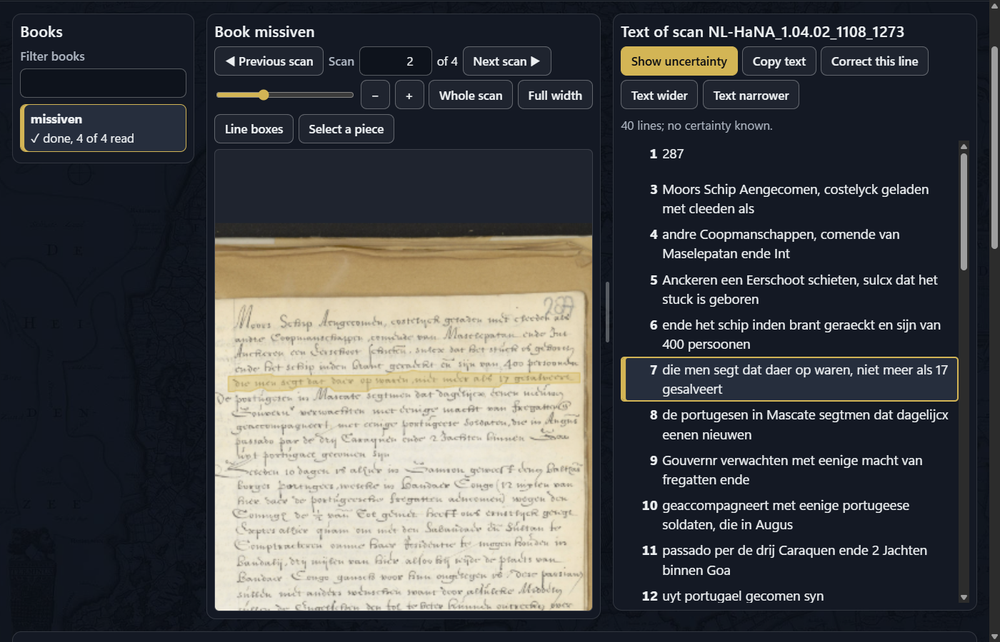

# Loghi-studio

A local web application around [Loghi](https://github.com/knaw-huc/loghi), the handwritten text
recognition software of the KNAW Humanities Cluster. It was made for 17th-century Frisian court,
orphan and recess books, and it is built to be fully usable with a keyboard and a screen reader.

Status: beta (0.x). The interface is in English, Dutch and Frisian.

Good to know:
- It is not a product of, and not connected with, the KNAW Humanities Cluster, the makers of Loghi.
- The login of the server mode is home-made. Judge for yourself before you put it on the internet.

A video of a minute and a half shows it at work, spoken in English:
[with English subtitles](docs/video/loghi-studio-demo-en.mp4) or
[with Dutch subtitles](docs/video/loghi-studio-demo-nl.mp4). What is said, as text:
[English](docs/video/loghi-studio-demo.en.srt), [Dutch](docs/video/loghi-studio-demo.nl.srt).

More pictures: [Correct](docs/screenshots/correct.png), [Search](docs/screenshots/search.png).
What we measured on our own books (enlarging scans, models, Transkribus, fine-tuning): [docs/FINDINGS.md](docs/FINDINGS.md).

## Starting
- Double-click `start_loghi_studio.bat`, or run `python server.py 8771`.
- Then open http://127.0.0.1:8771/
- Needed: Python 3.10 or newer. The application uses the standard library only; reading a book enlarged
  and the tests also need Pillow (`pip install pillow`). For reading books: Docker Desktop, the Loghi
  images (version 2.3.2) and a folder with the Loghi models.
- First use: open the tab Collections and add a folder. A collection is a folder with one folder per book;
  a book holds the scans (`000001.jpg`, ...) and, once Loghi has read it, `page/000001.xml` (PageXML) and
  `txt/000001.txt`. Books that Loghi read elsewhere can be used as they are, as long as they have this shape.
- Without Docker and Loghi everything except reading books works: looking, searching, the name finder
  and correcting.
- On the internet behind a login (server mode): see [deploy/SERVER-MODE.md](deploy/SERVER-MODE.md).

## What it does
- **View**: the scan next to the text that was read, line by line. Unsure lines get the tag `[?]`
  (unsure) or `[??]` (very unsure); hits of the name finder get the name as a tag.
  Drag a box over a piece of the scan (key S, or Shift while dragging) to see only the text of that piece.
- **Correct**: check a line against the scan. The line is shown cut from the scan, very large, above a
  field with the text; Enter saves and goes to the next line. A line that was read right is saved as it
  is. Every checked line is a training line for a better reading model.
  Three orders: reading order, unsure lines first, and, when a second reading of the book is at hand, the
  lines that the two readers read differently (where they differ, at least one is wrong).
- **Search**: loose, fuzzy (reading errors), names in old spellings, literal or regular expression. With
  an index of names made by people (field `index` of the collection) the deeds that name the person are
  listed first.
- **Name finder**: your own lists of names (name, other spellings, relatives, fuzzy or exact, per
  collection). Loghi-studio searches in the background and shows the hits per person. Many names can
  be imported at once, for example the people of a family tree; all hits can be downloaded as CSV.
- **Progress**: per collection in words and numbers, with a table of all books.
- **Add**: add a book from a folder with scans, or download it from Tresoar (finding aid number and
  inventory number). Optionally the book goes straight into the reading queue.
- **Queue**: the books that Loghi has to read, one at a time. Change the order, pause and resume,
  choose the reading model per book, set the number of threads, see the expected finishing time.
- **Collections**: add, change and remove from the list, with a folder chooser. Removing from the
  list never deletes anything from the disk.

## How the queue reads a book
- A book is read in chunks of 20 scans (adjustable). Each chunk goes through the six Loghi steps in
  Docker, in a work folder of its own; the result is then moved into `page/` and `txt/` of the book.
- After a stop, a crash or a reboot, only the chunk that was running is read again.
- A scan that fails is tried once more and skipped after the second failure. Skipped scans are
  listed in `.loghi-studio.json` in the book folder and can be tried again on request.
- When a Loghi step fails on a chunk, the chunk is halved until the scan that causes it is found.
- Pausing freezes the running container (`docker pause`); resuming continues exactly there.
- Containers are named `loghi-studio-*`. While another Loghi run is active on the computer, or while
  Docker is not running, the queue waits and continues by itself.
- The output of Loghi is kept per book in `cache/logs/`.

## How correcting works
- The scans, the PageXML and the text files of Loghi are never changed. Every checked line is one line in
  `settings/corrections/<collection>/<book>.jsonl`: what Loghi read, what is written, who, when, and the
  place of the line on the scan. Entries are only added; withdrawing a check adds an entry too.
- View, Search and the name finder show the checked text, with the tag `[corrected]`, `[checked]` (right
  as read) or `[unreadable]`. A check stays with its line when the scan is read again.
- Order: in reading order, the lines Loghi is least sure of first, or (when the collection has an index
  of names made by people, field `index`) the lines with a name that was nearly read right. The names
  of the deed on the scan are then shown as a help; the scan decides, not the index.
- Characters that the reading model does not know (its `charlist.txt`) give a warning while typing.
- **Training set** (button, own computer only): `training/<collection>/` with `gt/` (scans and PageXML
  with only the checked lines; a scan that was read enlarged goes in enlarged), `lines/` (line images cut
  by Loghi's own `MinionCutFromImageBasedOnPageXMLNew`, in Docker) and the lists `training_all.txt`,
  `training_all_train.txt`, `training_all_val.txt` with `<path><tab><text>`, the format of
  `scripts/htr-train-pipeline.sh` of Loghi. The folder is made again from all checks each time.
- A collection can be marked "scans for own use only" (FamilySearch): its training set gets the file
  `OWN-USE-ONLY.txt` and must not be shared.
- "Letters Loghi read wrong" in the table is the letter error rate of Loghi on the checked lines.
- Server mode: the admin and accounts with the role `corrector` may check lines; a viewer may not.

## How the name finder works
- Spelling is folded before comparing: capitals, accents, ij/y, ck/k, c/k, z/s, sz/s, v/f, ae/aa and
  doubled letters do not matter. In fuzzy mode a word of 5 to 8 letters may differ by one letter and a
  longer word by two; words of 4 letters or fewer must match.
- For an imported person the search forms are made automatically: first name + patronymic, first name
  + surname, and old spellings (Pieter/Pyter, Sybrant/Sybren, Hayes/Hayesen/Hayesdr, Trijntje/Trijn,
  Dirk/Durk/Derk). A person with only a first name is skipped; people with the same name share one entry.
- A hit is **strong** when the spelling matches exactly or Loghi is sure of the line, otherwise **weak**.
  A hit is **with a relative** when a relative of that person is named on the same scan. A name with
  more than 100 strong hits in a collection is a **very common name**; if it has relatives, only its
  hits with a relative are shown by default.
- An import file is text with one name per line (optionally `;` and a reference), or JSON: a list of
  objects with `name` and optionally `uid`, `given`, `surname`, `sex`, `aka`, `relatives`, `year`.
  `python tools_gedcom_names.py tree.ged out.json` makes such a file from a GEDCOM file.
- At most 300 hits per name per book are kept. The certainty of the lines is cached in `cache/conf/`.

## Accessibility
- Large text (buttons A− and A+). One dark theme: text has a contrast of at least 7:1 with its background,
  and of 12:1 or higher with the button High contrast.
- Everything works with the keyboard; tabs with the arrow keys; a visible focus ring.
- Labels for the screen reader; messages in a status line (`aria-live`).
- Meaning is never carried by colour alone: there is always a word or a symbol too.
- The Dark Reader extension is switched off for this page (`darkreader-lock`), because it lowers the contrast.

## Structure
- `server.py`: web server and API, Python standard library only. Listens on 127.0.0.1 only and
  refuses requests from other websites.
- `names.py`: the name finder. `books.py`: adding books. `readqueue.py`: the reading queue.
  `corrections.py`: lines checked by a person and the training set. `auth.py`: accounts in server mode.
- `tools_gedcom_names.py`: makes an import file for the name finder from a GEDCOM file.
- `reading_errors.json`: which letter changes are typical reading errors of Loghi, for the hits with a
  possible reading error. `tools_reading_errors.py` learns it from an index made by people (and measures
  what it brings with `--measure`). `tools_analiticcl_trial.py` is the record of the trial that led to it.
- `index.html`: the whole page, without a build step.
- `settings/`: collections, names, jobs and the queue (made on first start; not in git), and
  `corrections/`: the lines checked by people. The public code lets git ignore `settings/` as a whole,
  because checked lines can hold text of scans that may not be shared. To keep a copy of them in a private
  repository of your own: take `settings/corrections/` out of `.gitignore` there and make the file
  `settings/git_backup.on`. The server on the own computer then commits that folder by itself ten minutes
  after the last check and once when it starts, and pushes the branch (every commit of the branch that was
  not sent yet goes along). The Correct tab says when the last copy was made, or why it failed.
- `training/`: training sets made from the corrections (not in git; can be made again).
- `cache/`: search index, name hits and Loghi logs (not in git).
- `tests/`: `python -m unittest discover -s tests` (Docker is replaced by a fake; no scans are touched).

## Rules
- Text read by Loghi is a pointer; a find only counts after it has been read on the scan itself.
- Scans are never changed. Scans, models and the text read by Loghi do not go into git; the lines
  checked by people only when you switch that on (see Structure).
- Scans from FamilySearch are for personal use only.

## Known limits
- Tried on Windows 11 with Python 3.14 and Docker Desktop, and in a Linux container (server mode). Not on macOS.
- One user at a time on the own computer; server mode has three roles (admin, corrector, viewer). The admin
  makes the accounts; there is no registration. A forgotten password is asked from the admin on the login
  page; no e-mail is sent.
- The reading queue expects the Loghi images of version 2.3.2 and scans as JPG.
- The Frisian texts of the interface were not checked by someone who writes Frisian.
- The Correct tab is new and has seen little use. That checked lines make a better reading model is the
  aim, not yet a result: see docs/FINDINGS.md.
- No full round with a screen reader by an outside tester has been done yet. The login page has no button
  for high contrast.
- Server mode must be at the root of a host name of its own; a path such as example.org/loghi/ does not work.
- Several copies on one computer leave each other's Docker containers alone (each names them after its own
  settings folder), but they do not share the processor and the memory wisely. Let one copy read at a time.
- Parts of the code come from the first use and mean little elsewhere: the reading of a `batch.log`, the
  hits of older search scripts (`hits*.md`), and the research scripts `tools_*` and `runpod_jobs/`.

## Licence and credits
- Loghi-studio: MIT, see [LICENSE](LICENSE). Idea, design and testing: Johan Dijkstra. The code was written
  by Claude Fable 5.2 (Anthropic), working with him.
- [Loghi](https://github.com/knaw-huc/loghi) is made by the KNAW Humanities Cluster and has its own licence;
  so have the reading models (see the folder of each model). Loghi-studio calls Loghi's Docker images and
  holds no code of Loghi.
- `reading_errors.json` was learned from the index of names of AlleFriezen, fetched through Open Archives.
- The scan in the pictures is from the archive of the VOC at the Nationaal Archief (The Hague, 1.04.02);
  its text is from the GLOBALISE ground truth (doi:10.34894/IQ0YMT, CC-BY-SA-4.0). Because of that text
  the pictures in `docs/screenshots/` are under CC-BY-SA-4.0, not under the MIT licence.
- The video in `docs/video/` shows pages of a court book of Het Bildt of 1611 to 1613, kept at Tresoar in
  Leeuwarden (archive 13-07). The voice is the maker's own, copied by a computer (ElevenLabs). The video is
  not under the MIT licence.
- The faint map behind the page is the map of Friesland from the Schotanus atlas of 1718 (Rijksmuseum,
  RP-P-AO-2-12-1, public domain).
